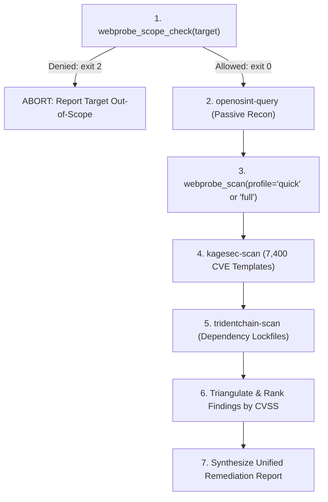

# `AGENT_VPS_DEPLOYMENT.md` — Agent Guide for VPS & MCP Deployment

This document is the operational manual for AI agents operating, deploying, or orchestrating scans across the **WebProbe & Wrapped Security Ecosystem** on a remote VPS.

---

## 1. Architectural Model — Two Layers, One Bridge

The system operates as a hybrid architecture designed to give maximum breadth without compromising the integrity or dependency footprint of `webprobe`:

```
Cloud / Local AI Agent
          │
          │ SSH stdio MCP Transport (Zero exposed ports, SSH key auth, ControlMaster)
          ▼
VPS Host (/opt/mcp/)
   │
   ├── [Guardrail] /opt/mcp/bin/_guard.py ← Strictly enforces /opt/mcp/config/scope.toml
   │
   ├── Layer 1: In-House Engine (WebProbe)
   │     └── /opt/mcp/repos/webprobe/backend/mcp_server.py
   │           • Zero external dependencies for scanner CLI
   │           • Deep stack-specific rules (Fastify, Next.js, Supabase, Razorpay)
   │           • Business logic, IDOR, race conditions, exploit chains
   │
   └── Layer 2: Wrapped Ecosystem (Each tool in an isolated venv)
         ├── KageSec      (/opt/mcp/venvs/kagesec/)      → 7,400 CVE templates & Playwright crawler
         ├── TridentChain (/opt/mcp/venvs/tridentchain/) → Supply-chain SCA vulnerability scans
         ├── Argus        (/opt/mcp/venvs/argus/)        → Unified SAST/DAST scanner orchestration
         ├── OpenOSINT    (/opt/mcp/venvs/openosint/)    → Passive OSINT & reconnaissance
         └── SAST Server  (Docker container)            → Static application security testing
```

---

## 2. Inventory of Components

### Local Repository vs Remote VPS Mapping

| Local Path in Repository | Remote Path on VPS | Description |
|---|---|---|
| [`deploy/vps/config/scope.toml`](file:///f:/Dev/Projects/tarunSisodia/jailbreaks/deploy/vps/config/scope.toml) | `/opt/mcp/config/scope.toml` | Target scope policy (allowlist and strict deny wildcards). |
| [`deploy/vps/bin/_guard.py`](file:///f:/Dev/Projects/tarunSisodia/jailbreaks/deploy/vps/bin/_guard.py) | `/opt/mcp/bin/_guard.py` | Standalone Python guardrail CLI. Exits `0` on permitted targets, `2` on denied. |
| [`deploy/vps/bin/webprobe`](file:///f:/Dev/Projects/tarunSisodia/jailbreaks/deploy/vps/bin/webprobe) | `/opt/mcp/bin/webprobe` | Bash wrapper that injects `PYTHONPATH=/opt/mcp/repos/webprobe/backend` and runs `backend/webprobe.py`. |
| [`deploy/vps/bin/kagesec-scan`](file:///f:/Dev/Projects/tarunSisodia/jailbreaks/deploy/vps/bin/kagesec-scan) | `/opt/mcp/bin/kagesec-scan` | Pre-checks target with `_guard.py` before invoking KageSec. |
| [`deploy/vps/bin/tridentchain-scan`](file:///f:/Dev/Projects/tarunSisodia/jailbreaks/deploy/vps/bin/tridentchain-scan) | `/opt/mcp/bin/tridentchain-scan` | Runs TridentChain against a local dependency manifest / lockfile. |
| [`deploy/vps/bin/openosint-query`](file:///f:/Dev/Projects/tarunSisodia/jailbreaks/deploy/vps/bin/openosint-query) | `/opt/mcp/bin/openosint-query` | Pre-checks domain with `_guard.py` before invoking OpenOSINT passive queries. |
| [`deploy/vps/bin/argus-scan`](file:///f:/Dev/Projects/tarunSisodia/jailbreaks/deploy/vps/bin/argus-scan) | `/opt/mcp/bin/argus-scan` | Pre-checks network target with `_guard.py` before invoking Argus. |
| [`backend/mcp_server.py`](file:///f:/Dev/Projects/tarunSisodia/jailbreaks/backend/mcp_server.py) | `/opt/mcp/repos/webprobe/backend/mcp_server.py` | Official MCP stdio server exposing WebProbe tools to AI agents. |
| [`deploy/vps/bootstrap.sh`](file:///f:/Dev/Projects/tarunSisodia/jailbreaks/deploy/vps/bootstrap.sh) | `/opt/mcp/bootstrap.sh` | Run-once VPS setup script. Creates layout, installs `uv`, Docker, and isolated venvs. |
| [`deploy/vps/sync_to_vps.sh`](file:///f:/Dev/Projects/tarunSisodia/jailbreaks/deploy/vps/sync_to_vps.sh) | N/A (Local helper) | Synchronizes configuration, bin wrappers, and repo to the VPS via SSH/tar/rsync. |
| [`deploy/vps/README.md`](file:///f:/Dev/Projects/tarunSisodia/jailbreaks/deploy/vps/README.md) | `/opt/mcp/README.md` | Human-facing quick-start and SSH configuration manual. |

---

## 3. Operational Safety & Guardrail Contract

### Guardrail Invariant
**No tool must ever fire a packet against an out-of-scope target.**
Both the CLI wrappers and the MCP server enforce `/opt/mcp/bin/_guard.py` before initializing or invoking scanners.

### Policy Rules in `scope.toml`
1. **Deny list takes strict precedence:**
   Any target matching `*.gov`, `*.mil`, `*.bank`, `*.edu` is immediately refused.
2. **Allow list evaluation:**
   Targets must explicitly match an authorized domain or be a subdomain of an entry in `allowed_hosts`.
3. **Exit codes:**
   - `0`: In-scope (authorized).
   - `2`: Out-of-scope (rejected/blocked).
   - `1`: Syntax/configuration error.

### Testing the Guardrail
```bash
# Check if a target URL or domain is permitted
python3 /opt/mcp/bin/_guard.py --check "https://agraskbagheltourandtravels.com"
echo $? # Must output: 0

python3 /opt/mcp/bin/_guard.py --check "https://target.gov"
echo $? # Must output: 2
```

---

## 4. MCP Tool Interfaces for AI Agents

When connected to the VPS via the MCP bridge, the agent has access to the following tools:

### `webprobe_scope_check`
- **Purpose:** Fast non-intrusive pre-flight check to verify if a target URL/domain is authorized under the active `scope.toml`.
- **Arguments:**
  - `target` *(string, required)*: Domain or URL (e.g. `https://agraskbagheltourandtravels.com`).
- **Returns:**
  `{"target": "...", "in_scope": true/false, "message": "..."}`

### `webprobe_scan`
- **Purpose:** Executes the WebProbe crawling and vulnerability assessment pipeline. Guardrail-checked.
- **Arguments:**
  - `url` *(string, required)*: Target base URL.
  - `profile` *(string, default: `"quick"`)*: One of `["quick", "recon", "auth", "injection", "authz", "business", "config", "owasp", "api", "full"]`.
    *(Note: Do NOT use `"chain"` as a profile name. `--chain` is an orthogonal boolean flag).*
  - `rate_limit` *(number, default: `3.0`)*: Requests per second.
  - `chain` *(boolean, default: `true`)*: Correlate related findings into compound exploits.
  - `max_pages` *(integer, default: `30`)*: Maximum pages to crawl.
- **Returns:**
  Structured JSON containing `findings_count`, `findings` (array of finding objects with `phase`, `severity`, `title`, `evidence`, `remediation`), and `stderr`.

### `webprobe_exploit`
- **Purpose:** Executes targeted verification chains (React2Shell, Supabase RLS, Razorpay webhook logic, race conditions). Guardrail-checked.
- **Arguments:**
  - `url` *(string, required)*: Target base URL.
  - `exploit_rce` *(boolean, default: `false`)*: Opt-in to execute bounded benign RCE proof (`id`).
  - `webhook_url` *(string, optional)*: Explicit webhook endpoint URL.
- **Returns:**
  Structured JSON verification report.

---

## 5. Direct CLI Invocation (Headless Shell Mode)

When the agent executes commands directly via SSH instead of MCP:

```bash
# 1. Scope check:
ssh vps /opt/mcp/bin/_guard.py --check "https://agraskbagheltourandtravels.com"

# 2. Run WebProbe full assessment:
ssh vps /opt/mcp/bin/webprobe https://agraskbagheltourandtravels.com --profile full --json -o /opt/mcp/logs/scan.json

# 3. Run KageSec CVE template matching:
ssh vps /opt/mcp/bin/kagesec-scan https://agraskbagheltourandtravels.com

# 4. Run OpenOSINT passive recon:
ssh vps /opt/mcp/bin/openosint-query agraskbagheltourandtravels.com

# 5. Run TridentChain supply-chain scan:
ssh vps /opt/mcp/bin/tridentchain-scan /path/to/package-lock.json

# 6. Run Argus SAST/DAST:
ssh vps /opt/mcp/bin/argus-scan https://agraskbagheltourandtravels.com
```

---

## 6. Recommended Agent Reasoning Workflow

When assigned an assessment task, the agent should follow this deterministic sequence:



1. **Gatekeeping:** Call `webprobe_scope_check`. If `in_scope` is `false`, refuse execution immediately.
2. **Reconnaissance:** Run `openosint-query` to discover subdomains, exposed records, and infrastructure details.
3. **Deep Stack Assessment:** Run `webprobe_scan` for custom application logic, auth bypasses, Supabase RLS, and IDORs.
4. **Broad Vulnerability Scanning:** Run `kagesec-scan` to match against known CVE templates.
5. **Supply Chain Audit:** Run `tridentchain-scan` against application manifests.
6. **Synthesis:** Merge findings, de-duplicate overlapping alerts, and format remediation plans.

---

## 7. Connecting to the MCP Bridge from Cloud / Local IDE

### SSH Multiplexing (`~/.ssh/config`)
Add this configuration to enable socket persistence and reduce latency to <15ms:
```ssh
Host vps.example.com
    HostName <vps-ip-address>
    User ubuntu
    IdentityFile ~/.ssh/id_rsa
    ControlMaster auto
    ControlPath ~/.ssh/control-%r@%h:%p
    ControlPersist 15m
    ServerAliveInterval 30
```

### Agent Client Registration (`claude_desktop_config.json` / Agent Settings)
```json
{
  "mcpServers": {
    "webprobe": {
      "command": "ssh",
      "args": [
        "vps.example.com",
        "/opt/mcp/venvs/webprobe/bin/python3",
        "/opt/mcp/repos/webprobe/backend/mcp_server.py"
      ]
    },
    "kagesec": {
      "command": "ssh",
      "args": [
        "vps.example.com",
        "/opt/mcp/venvs/kagesec/bin/kagesec",
        "mcp",
        "--stdio"
      ]
    },
    "openosint": {
      "command": "ssh",
      "args": [
        "vps.example.com",
        "/opt/mcp/venvs/openosint/bin/openosint",
        "mcp"
      ]
    },
    "argus": {
      "command": "ssh",
      "args": [
        "vps.example.com",
        "/opt/mcp/venvs/argus/bin/argus",
        "mcp",
        "--stdio"
      ]
    }
  }
}
```

---

## 8. Troubleshooting & Diagnostic Matrix for Agents

| Symptom / Error | Root Cause | Agent Action / Resolution |
|---|---|---|
| `Exit code 2: OUT OF SCOPE` | Target hostname not in `scope.toml` or matches `scope.deny`. | Do not bypass. If target is legitimate, request user update `deploy/vps/config/scope.toml` and sync. |
| `ModuleNotFoundError: No module named 'webprobe'` | Invoking `backend/webprobe.py` without setting `PYTHONPATH`. | Always invoke through `/opt/mcp/bin/webprobe` or prepend `PYTHONPATH=/opt/mcp/repos/webprobe/backend`. |
| `invalid choice: 'chain' (choose from ...)` | An agent passed `--profile chain`. | `--chain` is a boolean flag, not a profile. Use `--profile full` or `--profile quick` with `--chain`. |
| `kagesec: chromium executable not found` | Playwright browser binaries not installed in the kagesec venv. | Run `/opt/mcp/venvs/kagesec/bin/playwright install --with-deps chromium`. |
| `MCP stdio connection hangs / times out` | SSH host key prompt or lack of SSH key authentication. | Verify `ssh vps.example.com echo ok` works without interactive password prompt. |

