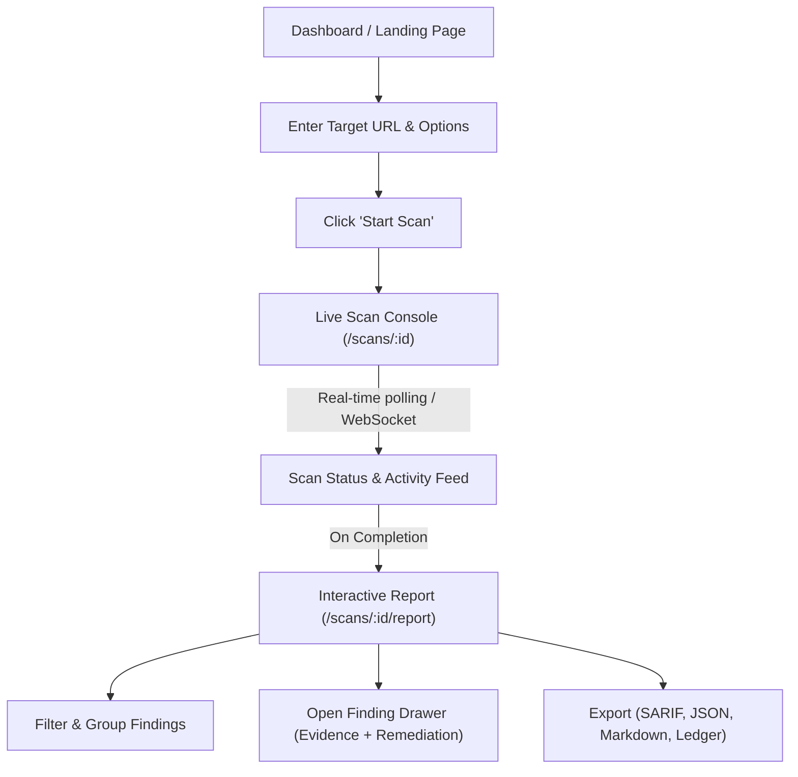

# Product Requirements Document (PRD)
## WebProbe UI — Web Security Scanner & Assessment Dashboard

**Document Version:** 1.0.0  
**Status:** Approved for Design & Engineering  
**Target Delivery:** Modern Web Dashboard (Next.js / React / Tailwind / shadcn/ui)  
**Backend API:** FastAPI `server.py` (`http://localhost:8080`)

---

## 1. Product Overview & Vision

### 1.1 Vision
**WebProbe UI** is an enterprise-grade, developer-friendly web vulnerability and logic assessment interface. It bridges the gap between complex command-line penetration testing tools and modern cloud developer dashboards (inspired by the sleek, minimalist aesthetics of Vercel, Linear, and Raycast).

Developers and security engineers can paste a target URL, select an audit profile, and receive clear, prioritized vulnerability reports with verifiable evidence, CVSS v3.1 scoring, and copy-paste remediation guidance.

### 1.2 Core Value Propositions
- **Zero-Friction Launch:** Type a URL, pick a profile (`Full`, `OWASP`, `Quick`, `API`), and start scanning immediately.
- **Real-Time Telemetry:** Live terminal logs, active phase indicators, and dynamic AIMD request throttling visualization.
- **Triage-First Reporting:** Instant categorization across Critical, High, Medium, Low, and Info severities with CVSS v3.1 score vectors.
- **Actionable Remediation:** Evidence drawer showing redacted HTTP requests/responses alongside immediate code-level fixes.
- **Developer Compliance Exports:** 1-click exports for SARIF 2.1.0 (GitHub Code Scanning), JSON, Markdown, and HMAC audit ledgers.

---

## 2. User Personas & Core Journeys

| Persona | Primary Goal | Key UI Needs |
|---|---|---|
| **Security Engineer / Pentester** | Run in-depth authenticated audits and logic checks. | Advanced mode for cookies, custom headers, rate-limiting, and deep checks (SQLi, IDOR, race conditions). |
| **Full-Stack Developer** | Quickly test a staging/production site before deployment. | Simple 1-click URL input, plain-English vulnerability descriptions, and exact fix code snippets. |
| **DevSecOps / Team Lead** | Track vulnerability health and generate audit artifacts. | Severity summary donuts, SARIF export for CI/CD, and tamper-evident audit ledger downloads. |

### Core User Flow


---

## 3. Information Architecture & Sitemap

```
├── / (Dashboard)
│   ├── Quick Scan Hero (URL Input + Profile Selector)
│   ├── Overview Metric Cards (Scans Run, High/Critical Vulns, Health)
│   └── Recent Scans Table
├── /scans
│   ├── Filterable Scan History (URL, Profile, Status, Date)
│   └── Active Scans Queue
├── /scans/new (Scan Launcher Wizard)
│   ├── Mode Toggle: Simple vs. Advanced
│   ├── Target Configuration (URL, Scope)
│   ├── Profile Picker (Cards: quick, full, owasp, api, auth, recon)
│   └── Operational Controls Accordion (Cookies, AIMD, Rate limits, Abort file)
├── /scans/:id (Live Scan Console)
│   ├── Header Banner (Target, Profile, Status Badge, Elapsed Time)
│   ├── Action Bar (Abort Scan, Pause, Refresh)
│   ├── Progress Stepper (Recon -> Auth -> Injection -> Authz -> Logic -> Infra)
│   └── Live Console Drawer (Collapsible raw output feed)
├── /scans/:id/report (Interactive Audit Results)
│   ├── Executive Summary Banner (CVSS Max, Total Findings, Pass/Fail Gauge)
│   ├── Severity Breakdown Bar (Critical, High, Medium, Low, Info)
│   ├── Filter & Search Controls (Search text, Phase filter, Category filter)
│   ├── Findings Table / Grid Cards
│   └── Finding Detail Drawer (Right side-sheet with Tabs: Overview, Evidence, PoC, Remediation)
├── /catalog (Check Catalog)
│   └── Explorer of all 136 registered checks across 6 phases with search and filter
└── /settings
    ├── Backend API Endpoint configuration
    ├── Webhook Callback Defaults
    └── Theme & Display Preferences
```

---

## 4. Screen-by-Screen Detailed Specifications

### 4.1 Screen 1: Dashboard (`/`)
- **Top Bar:**
  - Logo (`WebProbe` with radar/shield icon).
  - Backend status indicator pill (`Connected to v3.0.0` with green pulse dot).
  - Dark / Light mode toggle (Default: Dark Mode, Zinc palette).
- **Hero Scan Launcher:**
  - Prominent search-style bar: `https://your-domain.com`.
  - Profile quick-selector pills: `[⚡ Quick]` `[🛡️ OWASP Top 10]` `[🔍 Full Audit]` `[🔌 API]`.
  - Big primary CTA button: **"Start Assessment"** (shortcut: `Enter`).
  - Text link underneath: *"Need authentication or advanced rate limits? Switch to Advanced Configuration →"*.
- **Metrics Summary Cards:**
  1. *Total Scans Conducted*
  2. *Critical / High Risks Discovered*
  3. *Average Scan Runtime*
  4. *Clean Endpoints Audited*
- **Recent Scans Table:**
  - Columns: Target, Profile, Findings (Pills: 2 Crit, 5 High), Duration, Date, Status (`Completed`, `Failed`, `Running`), Actions (`View Report`, `Re-run`).

---

### 4.2 Screen 2: Advanced Scan Wizard (`/scans/new`)
- **Tab 1: Target Definition**
  - Input: Target URL with auto-scheme detection (`http://` / `https://`).
- **Tab 2: Scan Profiles & Scope**
  - Interactive grid of selectable cards:
    - **`quick`**: 7 checks — Fast smoke test (Headers, CORS, basic SQLi/XSS).
    - **`full`**: 136 checks — Comprehensive detection across all 6 phases.
    - **`owasp`**: 21 checks — OWASP Top 10 web application vulnerabilities.
    - **`api`**: 15 checks — REST & GraphQL endpoints, mass assignment.
    - **`recon`**: 12 checks — Sitemaps, robots.txt, JS endpoints, source maps.
    - **`auth`**: 16 checks — Password policies, lockout, JWT, session security.
- **Tab 3: Authentication & Identity (Optional)**
  - Primary Session Cookie input (e.g. `sb-access-token=...; token=...`).
  - Secondary User Cookie input (enables cross-tenant IDOR validation).
  - Admin Cookie input (enables vertical privilege escalation testing).
- **Tab 4: Operational Controls & Safety Guardrails**
  - Rate limit slider: `1.0` to `20.0` RPS (Default: `3.0` RPS).
  - Toggle: **Adaptive Rate Limiting (AIMD)** (Default: `ON`).
  - Toggle: **PII & Secret Scrubbing (Redact)** (Default: `ON`).
  - Toggle: **Exploit Chaining** (Default: `ON`).
  - Webhook Notification URL (Optional callback on finish).

---

### 4.3 Screen 3: Live Scan Console (`/scans/:id`)
- **Header:**
  - Target URL with external link icon.
  - Active status badge (`RUNNING` with animated spinner, `QUEUED`, `COMPLETED`, `ABORTED`).
  - Stop button: **"Emergency Abort"** (calls backend abort handler).
- **Phase Progress Bar:**
  - Visual 6-step horizontal timeline:
    1. Phase 1: Recon & Discovery
    2. Phase 2: Authentication
    3. Phase 3: Injection Probes
    4. Phase 4: Access Control (IDOR)
    5. Phase 5: Business Logic
    6. Phase 6: Infrastructure & TLS
- **Live Metric Counter:**
  - Running elapsed time (e.g., `01:42s`).
  - Current finding tally (live counter of findings detected so far).
- **Terminal Log Stream:**
  - Monospace dark terminal box with ANSI color rendering.
  - Auto-scroll lock toggle, search bar, and "Copy Log" button.

---

### 4.4 Screen 4: Interactive Report View (`/scans/:id/report`)
- **Action Header:**
  - Target & scan timestamp.
  - Export Dropdown:
    - `Download JSON (.json)`
    - `Download Markdown (.md)`
    - `Download SARIF 2.1.0 (.sarif)`
    - `Download Audit Ledger (.ledger)`
- **Vulnerability Breakdown Bar:**
  - Horizontal stacked bar showing distribution:
    - 🔴 Critical (Score 9.0 - 10.0)
    - 🟠 High (Score 7.0 - 8.9)
    - 🟡 Medium (Score 4.0 - 6.9)
    - 🔵 Low (Score 0.1 - 3.9)
    - ⚪ Info (Score 0.0)
- **Findings Table:**
  - Search input (searches titles, URLs, parameters, CWE).
  - Phase filter dropdown.
  - Table Columns:
    - **Severity Badge** (`CRITICAL`, `HIGH`, `MED`, `LOW`, `INFO`).
    - **Vulnerability Title** (e.g. `Server-Side Template Injection (SSTI)`).
    - **Affected Endpoint & Parameter** (`POST /book.html?param=destination`).
    - **Category & Taxonomy** (`CWE-1336`, `A03:2021`).
    - **CVSS v3.1 Base Score** (`9.8`).
    - **Action** (`Inspect Details →`).

---

### 4.5 Component 5: Finding Detail Slide-over Drawer
When a user clicks on any finding in the table, a smooth right-side drawer slides in:
- **Header:**
  - Severity badge + Title.
  - CVSS v3.1 base score pill and interactive vector breakdown tag (`CVSS:3.1/AV:N/AC:L/PR:N/UI:N/S:U/C:H/I:H/A:H`).
- **Tab 1: Overview & Mechanism**
  - Vulnerability explanation in plain language.
  - Affected URL and Method (`GET`, `POST`, `PUT`, `DELETE`).
  - Target parameter / header.
- **Tab 2: Evidence & HTTP Proof**
  - Code-formatted block showing exact request sent and response received.
  - Redacted sensitive chips highlighted (e.g. `[REDACTED:jwt:ey...h8a2]`).
  - Copyable cURL reproduction command.
- **Tab 3: Remediation & Fix Guidance**
  - Actionable checklist to resolve the flaw.
  - Code snippets (e.g. input sanitization, parameterized query, or CSP header additions).
  - External documentation references (OWASP Cheat Sheet, CWE link).

---

## 5. Design System & Style Guidelines

### 5.1 Color Palette (Dark Mode First - Zinc & Emerald Accent)
- **Backgrounds:**
  - `bg-background`: `#09090b` (Deep Zinc)
  - `bg-card`: `#121215` (Elevated Zinc)
  - `bg-muted`: `#18181b` (Secondary Card / Input BG)
  - `border`: `#27272a` (Subtle divider)
- **Text:**
  - `text-primary`: `#fafafa`
  - `text-muted-foreground`: `#a1a1aa`
- **Severity Colors:**
  - **Critical:** `#ef4444` (Vibrant Red) / Background: `rgba(239, 68, 68, 0.12)`
  - **High:** `#f97316` (Orange) / Background: `rgba(249, 115, 22, 0.12)`
  - **Medium:** `#f59e0b` (Amber) / Background: `rgba(245, 158, 11, 0.12)`
  - **Low:** `#3b82f6` (Blue) / Background: `rgba(59, 130, 246, 0.12)`
  - **Info:** `#64748b` (Slate) / Background: `rgba(100, 116, 139, 0.12)`
- **Brand Accent:**
  - `#10b981` (Emerald / Terminal Green) for successful states, verified signatures, and primary actions.

### 5.2 Typography
- **Headings & Body:** Inter / Geist Sans
- **Terminal, Code, CVSS Vectors, & Evidence:** Geist Mono / JetBrains Mono

---

## 6. Frontend Technical Stack

| Layer | Recommended Technology |
|---|---|
| **Framework** | Next.js 14/15 (App Router, React Server Components + Client Views) |
| **Styling** | Tailwind CSS v3/v4 |
| **UI Components** | [shadcn/ui](https://ui.shadcn.com/) (Radix UI primitives) |
| **Icons** | `lucide-react` |
| **Data Fetching / State** | `@tanstack/react-query` (with 2-second polling for active scans) |
| **Charts** | `recharts` or `@tremor/react` (for severity donuts and timeline graphs) |
| **Code Highlighting** | `prismjs` or `@shikijs/core` (for evidence drawer) |
| **Table Virtualization** | `@tanstack/react-table` |

---

## 7. Backend API Integration Map

The frontend communicates with `server.py` via HTTP REST:

| UI Action | Endpoint | Method | Request Payload | Response |
|---|---|---|---|---|
| **Health Check** | `/health` | `GET` | None | `{ status: "healthy", total_checks: 136, profiles: [...] }` |
| **List Profiles** | `/profiles` | `GET` | None | `{ full: { count: 136, checks: [...] }, ... }` |
| **Launch Scan** | `/scan` | `POST` | `{ url, profile, rate_limit, aimd, redact, cookie, ... }` | `{ scan_id: "uuid", status: "queued", status_url: "..." }` |
| **Poll Status** | `/scan/:id` | `GET` | None | `{ scan_id, status, findings_count, severity_summary, duration_seconds }` |
| **Get Report (JSON)** | `/scan/:id/report?format=json` | `GET` | None | Full JSON audit report with all findings and metadata |
| **Get Report (MD)** | `/scan/:id/report?format=md` | `GET` | None | Markdown report string |
| **Get Report (SARIF)** | `/scan/:id/report?format=sarif` | `GET` | None | OASIS SARIF v2.1.0 standard JSON file download |
| **Get Live Log** | `/scan/:id/report?format=log` | `GET` | None | Terminal execution log lines |
| **List Recent Scans** | `/scans?limit=50` | `GET` | None | `[ { scan_id, url, profile, status, ... }, ... ]` |

---

## 8. Non-Functional Requirements & Security

1. **Input Sanitization:** URL input must enforce RFC 3986 format with strict protocol validation (`http://` or `https://`).
2. **Safe Rendering:** Any HTML or script evidence displayed in the Evidence Drawer must be rendered in plain-text code blocks or sanitized via DOMPurify to prevent stored XSS in the dashboard itself.
3. **Responsive Design:** Fully responsive layout across desktop (1440px+), laptop (1024px), and tablet (768px).
4. **Offline / Disconnected Resilience:** When a scan takes several minutes, the client uses TanStack Query exponential backoff and stores recent scan IDs in `localStorage` so a browser refresh never loses the scan state.

---

## 9. Immediate Implementation Checklist for Agent / Engineer

- [ ] Initialize Next.js project with Tailwind CSS & shadcn/ui.
- [ ] Install dependencies: `lucide-react`, `@tanstack/react-query`, `@tanstack/react-table`, `recharts`.
- [ ] Create API client service in `lib/api.ts` pointing to `NEXT_PUBLIC_API_URL` (defaulting to `http://localhost:8080`).
- [ ] Implement Global Layout (`components/navbar.tsx`, `components/footer.tsx`).
- [ ] Build Dashboard Screen with Hero URL Input (`app/page.tsx`).
- [ ] Build Live Scan Console with progress bar (`app/scans/[id]/page.tsx`).
- [ ] Build Findings Table & Sliding Drawer (`components/report/findings-table.tsx`, `components/report/finding-drawer.tsx`).
- [ ] Add 1-click Download buttons for JSON, Markdown, and SARIF.
