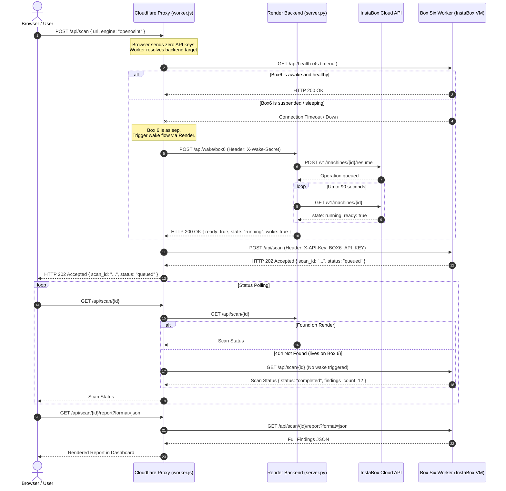

# WebProbe System Architecture & Integration Guide

This document explains **what** the system does, **how** all the components communicate, and **where** every piece of code, infrastructure, and configuration lives.

---

## 1. Executive Summary: What is Happening?

**WebProbe** is an automated web application vulnerability and security logic assessment platform. It coordinates four security scanning engines across a hybrid, multi-tier cloud infrastructure:

1. **WebProbe (Built-in)**: 136 in-house checks across 11 profiles covering authentication, IDOR, authorization, SQLi, SSTI, business logic flaws, and misconfigurations.
2. **KageSec (DAST)**: Active crawler with Playwright-driven headless Chromium and 7,400+ CVE vulnerability templates.
3. **OpenOSINT (Recon)**: Passive intelligence gathering across DNS, WHOIS, RDAP, open exposures, and search dorks.
4. **Argus (SAST/SCA)**: Code-level security scanner orchestrating Semgrep, Bandit, Gitleaks, and Pip-Audit across repository code.

To balance **speed**, **compute cost**, and **heavy binary dependencies**, the architecture is intentionally split into three separate environments:
- An **edge proxy & frontend** on Cloudflare Workers.
- An **always-on lightweight orchestrator** on Render.
- An **on-demand compute worker ("Box six")** on InstaBox that auto-suspends when idle.

---

## 2. Where Everything Lives (Topology Map)

```
┌────────────────────────────────────────────────────────────────────────┐
│                        TIER 1: CLOUDFLARE EDGE                         │
│                                                                        │
│  URL: https://jailbreaks.coccoder999.workers.dev                       │
│  Code: frontend/src/ (React UI), frontend/worker.js (Edge Proxy)       │
│  • Single-Page Application (SPA) dashboard                             │
│  • Holds all backend secrets server-side (zero browser credentials)    │
│  • Routes scan requests by engine                                      │
└───────────────────┬────────────────────────────────┬───────────────────┘
                    │                                │
         engine == 'webprobe'          engine in (kagesec, openosint, argus, all)
                    │                                │
                    ▼                                ▼
┌───────────────────────────────────────┐   ┌────────────────────────────────────┐
│      TIER 2: PRIMARY BACKEND          │   │      TIER 3: COMPUTE WORKER        │
│             (RENDER)                  │   │        ("BOX SIX" / INSTABOX)      │
│                                       │   │                                    │
│ URL: https://jailbreaks-46uf...       │   │ URL: https://8000-agq3oekm7...     │
│ Host: Render Web Service (Always-On)  │   │ Host: InstaBox VM (Auto-suspends)  │
│ Code: backend/server.py               │   │ Code: /opt/instabox/apps/webprobe/ │
│ • Executes WebProbe checks            │   │ • Executes KageSec + Chromium      │
│ • Manages Box 6 lifecycle via         │   │ • Executes OpenOSINT               │
│   InstaBox API: POST /api/wake/box6   │   │ • Executes Argus SAST toolchain    │
│ • Uploads scan reports to R2          │   │ • Auto-suspends after 30 min idle  │
└───────────────────┬───────────────────┘   └────────────────────────────────────┘
                    │                                ▲
                    │ POST /v1/machines/:id/resume   │ Resumes VM
                    └──────────► InstaBox API ───────┘
```

### Component Directory & Path Reference

| Component | Physical Host / Cloud Service | Live URL / Endpoint | Code Repository Location |
|---|---|---|---|
| **Frontend UI** | Cloudflare Workers Assets | `https://jailbreaks.coccoder999.workers.dev` | [`frontend/src/`](file:///f:/Dev/Projects/tarunSisodia/jailbreaks/frontend/src) |
| **Workers Proxy** | Cloudflare Workers Runtime | `https://jailbreaks.coccoder999.workers.dev/api/*` | [`frontend/worker.js`](file:///f:/Dev/Projects/tarunSisodia/jailbreaks/frontend/worker.js) |
| **Primary Backend** | Render (`jailbreaks-46uf`) | `https://jailbreaks-46uf.onrender.com/api` | [`backend/server.py`](file:///f:/Dev/Projects/tarunSisodia/jailbreaks/backend/server.py) |
| **Box 6 Worker** | InstaBox VM (`m_agq3oekm7yaprv7dohu23wsj2y`) | `https://8000-agq3oekm7yaprv7dohu23wsj2y.instabox.tech/api` | VPS path: `/opt/instabox/apps/webprobe/` |
| **InstaBox API** | InstaBox Control Plane | `https://api.instabox.sh/v1` | External Cloud API |

---

## 3. How It Works: Request Lifecycle & Wake Flow

### Sequence Diagram: Heavy Scan Dispatch (`openosint` / `kagesec` / `argus`)



---

## 4. Key Architectural Decisions & Safeguards

### A. Permanent Public Port on InstaBox (No Rotating Tokens)
- **The Problem**: InstaBox `--private` ports require rotating tokens (`?_token=ibp_...`) that expire or change whenever a VM resumes, breaking automated webhooks and proxies.
- **The Solution**: Port 8000 on Box 6 is published with `access: "public"`. 
- **Security Guarantee**: 
  - The URL (`https://8000-agq3oekm7yaprv7dohu23wsj2y.instabox.tech`) is protected by **WebProbe's built-in authentication**.
  - Any request without `X-API-Key: BOX6_API_KEY` is rejected with `401 Unauthorized`.
  - Only the Cloudflare Worker holds this key, so public access to port 8000 exposes zero unauthorized endpoints.

### B. Zero-Credential Browser Model
- The browser Single-Page Application never stores, sees, or transmits API keys.
- All requests are issued same-origin to `/api/*`.
- The Cloudflare Worker injects credentials server-side from its environment variables before dispatching to Render or Box 6.

### C. Honest Fallback Policy
- If an assessment requests a URL engine (`kagesec`, `openosint`, `all`) and Box 6 fails to resume, the proxy falls back to running the always-on `webprobe` engine on Render, returning explicit metadata:
  ```json
  {
    "fallback": true,
    "engine_used": "webprobe",
    "requested_engine": "all",
    "note": "Full engines were asleep, ran WebProbe only."
  }
  ```
  The fallback fields are sent to Render with the fallback request and persisted in the scan record and report metadata, so the notice survives navigation and refresh.
- Box 6 scan metadata is mirrored to Render through `POST /api/scans/mirror`; `GET /api/scans` on the Workers proxy merges Render scans with `GET /api/remote-scans`. This makes full-engine scans visible in history without polling or waking Box 6. Status/report reads still go to Box 6, and mirrored records are deliberately excluded from Render's local `/api/scan/{id}` lookup.
- **Argus** (Code Scanner) has no Render equivalent (it requires local git cloning, Semgrep, Bandit, and Pip-Audit installed only on Box 6). If Box 6 does not wake, Argus returns **HTTP 503** with a clear explanation instead of a silent fallback.

### D. CORS & SSRF Guardrails
- **CORS Protection**: The Workers proxy and Render backend strictly check `Origin` headers against `ALLOWED_ORIGINS` (`https://jailbreaks.coccoder999.workers.dev,http://localhost:5173`). Foreign origins receive `400 Bad Request`.
- **SSRF Prevention**: Before scanning any URL or invoking a webhook, the backend resolves all IP addresses via DNS. Any target resolving to private, loopback, or cloud-metadata IP ranges (`127.0.0.0/8`, `10.0.0.0/8`, `172.16.0.0/12`, `192.168.0.0/16`, `169.254.0.0/16`, `::1`, etc.) is immediately rejected with `400 Bad Request`.

---

## 5. Configuration & Environment Variables Matrix

### 1. Cloudflare Workers (`frontend/worker.js` & `wrangler.jsonc`)
| Variable | Value / Description |
|---|---|
| `RENDER_API_URL` | `https://jailbreaks-46uf.onrender.com/api` (Render backend endpoint) |
| `RENDER_API_KEY` | Secret API key required by the Render backend |
| `BOX6_API_URL` | `https://8000-agq3oekm7yaprv7dohu23wsj2y.instabox.tech/api` (Box 6 endpoint) |
| `BOX6_API_KEY` | Secret API key required by the Box 6 worker |
| `WAKE_URL` | `https://jailbreaks-46uf.onrender.com/api/wake/box6` (Wake endpoint on Render) |
| `WAKE_SECRET` | Shared secret sent in `X-Wake-Secret` to authorize wake operations |
| `ALLOWED_ORIGINS` | `https://jailbreaks.coccoder999.workers.dev,http://localhost:5173` |

### 2. Render Backend (`jailbreaks-46uf` Dashboard Environment)
| Variable | Value / Description |
|---|---|
| `WEBPROBE_API_KEY` | API key validating incoming scan requests from Cloudflare Worker |
| `WAKE_SECRET` | Shared secret validating incoming `/api/wake/box6` wake triggers |
| `INSTABOX_API_KEY` | InstaBox account API key used by Render to issue `/v1/machines/:id/resume` |
| `INSTABOX_BOX6_MACHINE_ID` | `m_agq3oekm7yaprv7dohu23wsj2y` (Identifies the target machine to resume) |
| `BOX6_HEALTH_URL` | `https://8000-agq3oekm7yaprv7dohu23wsj2y.instabox.tech/api/health` |
| `WEBPROBE_ALLOWED_ORIGINS` | `https://jailbreaks.coccoder999.workers.dev,http://localhost:5173` |

### 3. Box 6 Worker Host (`/opt/instabox/config/webprobe.env`)
| Variable | Value / Description |
|---|---|
| `WEBPROBE_API_KEY` | API key validating incoming scan requests from Cloudflare Worker |
| `ARGUS_BIN` | `/opt/instabox/apps/webprobe/backend/.venv-argus/bin/argus` |
| `WEBPROBE_ALLOWED_ORIGINS` | `https://jailbreaks.coccoder999.workers.dev,http://localhost:5173` |

---

## 6. Maintenance & Troubleshooting Runbook

### How to verify the entire system is healthy:
Run this three-point check from any terminal:

```bash
# 1. Edge Proxy Health (should return healthy, proxy: workers, all 4 engines)
curl -s https://jailbreaks.coccoder999.workers.dev/api/health

# 2. Render Backend Health (should return healthy, 136 checks)
curl -s https://jailbreaks-46uf.onrender.com/api/health

# 3. Box 6 Worker Health (should return healthy, engines: webprobe, kagesec, openosint, argus)
curl -s https://8000-agq3oekm7yaprv7dohu23wsj2y.instabox.tech/api/health
```

### How to SSH into Box 6 directly for maintenance:
```bash
ssh -p 2222 ibssh_yiv4ua3ugiiw7gp3n43ecxuezi@ssh.instabox.sh
# Check systemd status
systemctl status webprobe
# View live logs
journalctl -u webprobe -f
```
